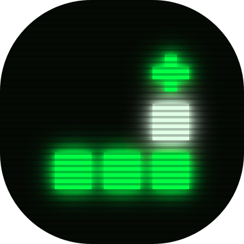
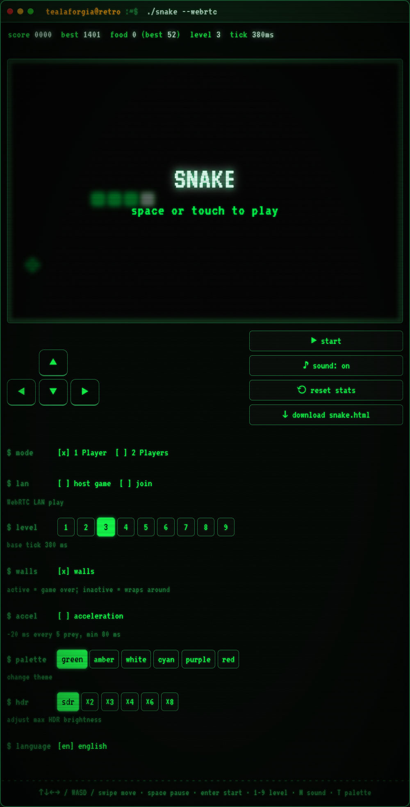
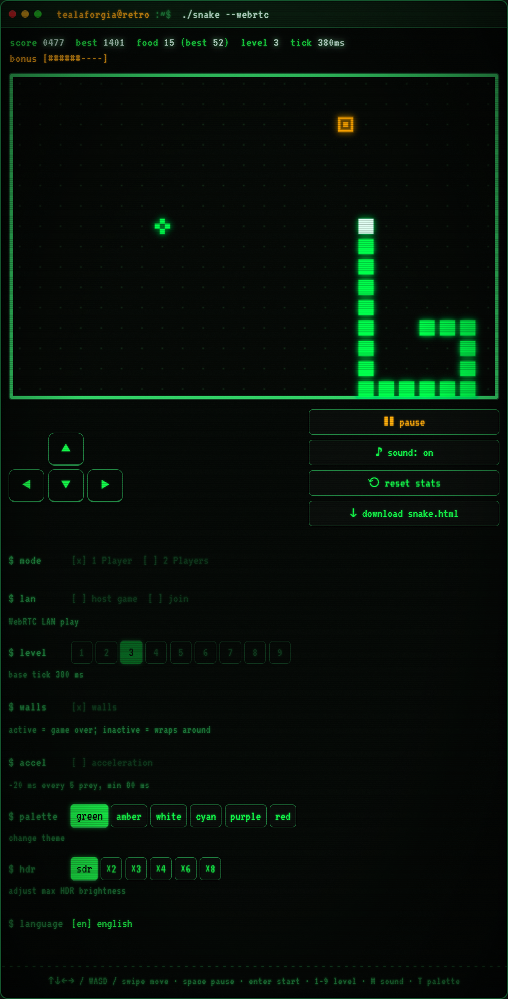
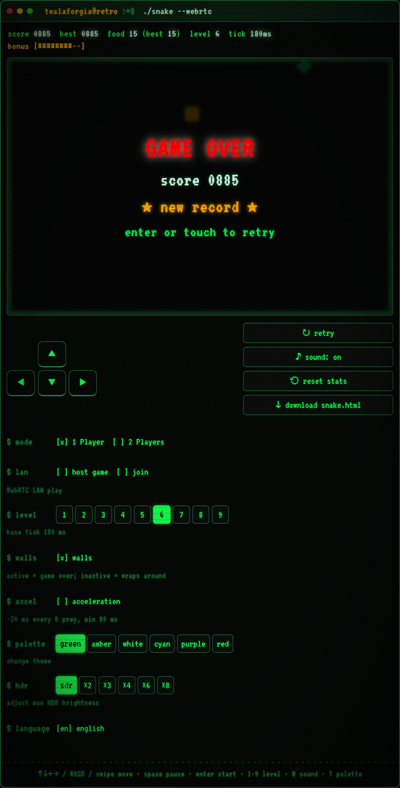
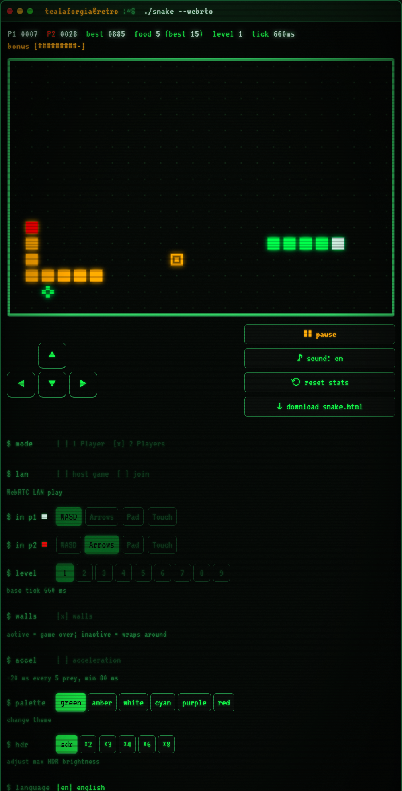
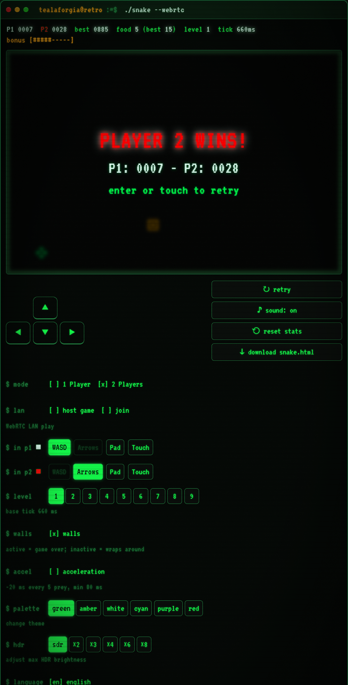
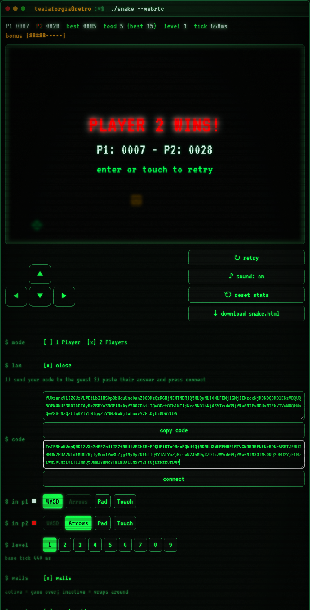
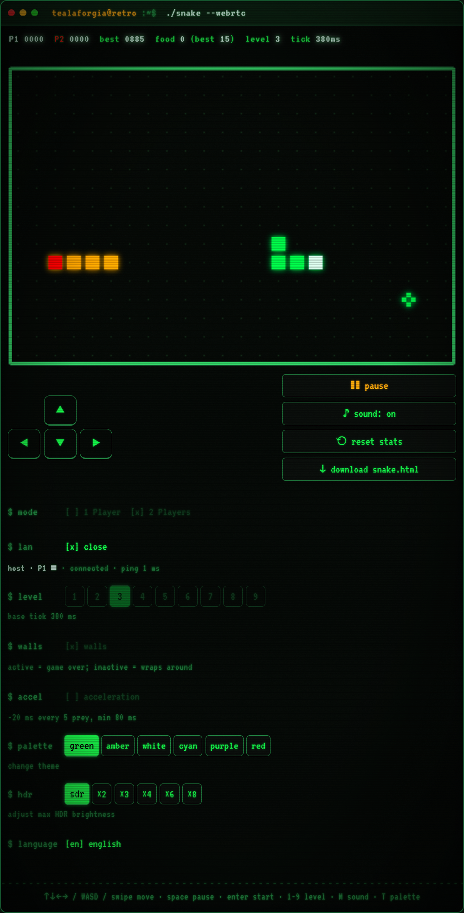
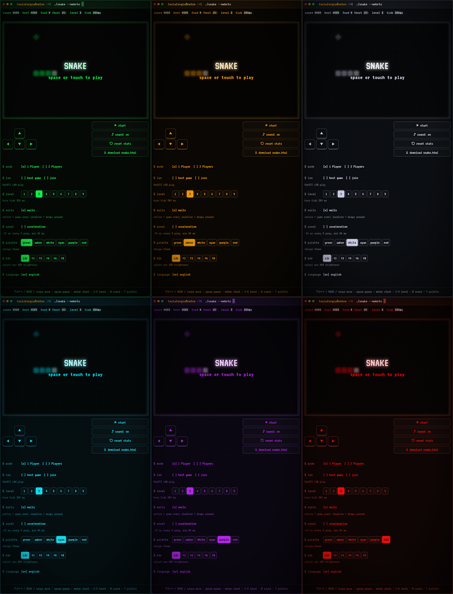

# Snake-WebRTC

Retro Snake game with 1P/2P modes, WebRTC LAN multiplayer, WebGPU HDR rendering. A modern, hyper-portable take on the classic retro game.

**Play it live:** [laforgia.xyz/snake.html](https://www.laforgia.xyz/snake.html)

## About the Project

What originally started as a hidden easter egg for my personal website quickly evolved into a much more ambitious project. Developed with the assistance of LLMs, this game brings the nostalgic Snake experience into the modern web era using cutting-edge browser APIs. 

The best part? **It's completely serverless.** Everything — gameplay, rendering, and even LAN multiplayer — is packed into a single, standalone HTML file. 

## Quick Start

1. Download [`snake.html`](snake.html).
2. Double-click the file to open it directly in your favorite modern web browser.
3. Play!

## Features

* **Zero Dependencies:** A truly single-file application. HTML, CSS, and JavaScript are bundled together. You can play it completely offline from your local filesystem.
* **WebRTC LAN Multiplayer:** Play against a friend on the same local network without any backend server. The game uses a manual SDP connection handshake to establish a direct Peer-to-Peer connection.
* **Local Multiplayer:** Share the same keyboard or screen to play competitively in a classic 1v1 local mode.
* **WebGPU HDR Rendering:** Experience authentic, glowing CRT aesthetics. If you have an HDR-capable display, the game leverages WebGPU to push display-P3 HDR colors. *(Note: HDR canvas works on Chromium-based browsers, but is unsupported on Firefox at this time).*
* **Responsive & Mobile-Ready:** Flawlessly adapts to any screen size. Features specific CSS optimizations for mobile browsers, including safe-area insets and touch-action handling.
* **Multiple Input Methods:** Fully playable via physical keyboard (WASD/Arrows), an on-screen touch D-pad, or swipe gestures for mobile devices. Each player can map their preferred input independently.
* **Customizable Themes:** Switch between different retro color palettes (Green, Amber, White, Cyan, Purple, Red) on the fly.
* **Procedural Web Audio:** Custom sound effects are synthesized dynamically in real-time using the Web Audio API.
* **Gameplay Modifiers:** 
  * **Dynamic Difficulty:** Optional acceleration mode that dynamically reduces tick time as you consume more food.
  * **Wall Wrapping:** Play with solid borders or wrap-around borders.
  * **Pacing Control:** Choose between 9 different base speed levels.
* **Bonus Mechanics:** Keep an eye out for a time-limited bonus target that spawns every 5 items consumed to boost your score.
* **Persistent Local Storage:** Automatically saves your high score, maximum food eaten, selected language, palette, and HDR peak brightness settings locally in your browser.
* **Multilingual Support:** Native support for English and Italian (if you would like to add another language, you are welcome to do so). The game auto-detects your browser's language on startup and offers a manual toggle.
* **Embed-Friendly:** Automatically detects if it's running inside an `iframe` and adjusts its layout and background effects.

## Multiplayer Guide

To play with a friend over the local network:
1. Both players must open `snake.html` (or open a hosted version).
2. **Player 1 (Host):** Go to `$ lan`, select `[x] host game`, and copy the generated connection code. Send this code to Player 2.
3. **Player 2 (Guest):** Go to `$ lan`, select `[x] join`, paste Player 1's code into the input field, and click **connect**. A response code will be generated. Send this back to Player 1.
4. **Player 1 (Host):** Paste Player 2's response code into the second input field and click **connect**. 
5. The Peer-to-Peer WebRTC connection is now established!

## Screenshot

  
  
  
  
  
  
  
  

  

## A Tactical Secret...

*Kept you waiting, huh?* 

If you manage to clear the entire screen and achieve a perfect victory—or if you fail miserably without eating a single thing—pay close attention to your screen. You might intercept a transmission on frequency **140.85**. Survival is a solitary game, but you're never truly alone on the battlefield.
